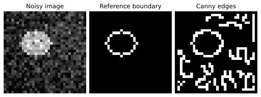

# Canny Edge Detection

How close is a detected edge to the actual boundary of a noisy shape? A synthetic mask supplies the location to within a pixel.

[Executed notebook](canny_edge_detection.ipynb) · [Python script](canny_edge_detection.py)

## Boundary matching

Precision credits a detected pixel within 1.5 pixels of a reference edge. Recall applies the same rule in the opposite direction.

## Compare outlines

The thresholds are fixed across 80 newly drawn images.

## Recorded output

```text
Boundary precision 0.274 | Recall 0.996 | F1 0.430
```

## Reading the result

A one-pixel contour shift has little visual effect at this resolution. Matching with a tolerance makes that choice explicit.



## References

[Canny, A Computational Approach to Edge Detection (1986)](https://doi.org/10.1109/TPAMI.1986.4767851)

[scikit-image, Canny edge detection](https://scikit-image.org/docs/stable/api/skimage.feature.html#skimage.feature.canny)

[Image and video generators and evaluation](../../gallery/vision.py)
