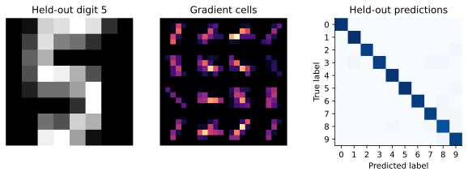

# HOG and Linear SVM

Gradient orientations describe the strokes of a digit. A linear margin classifier then works on those local histograms.

[Executed notebook](hog_and_linear_svm.ipynb) · [Python script](hog_and_linear_svm.py)

## Stroke descriptors

Upsampling provides room for spatial cells. It adds no new source pixels.

## Classify held-out digits

The scaler and classifier are fitted on the training descriptors.

## Recorded output

```text
Accuracy 0.971 | Balanced accuracy 0.971 | MCC 0.968
```

## Reading the result

A confusion between similarly shaped digits can persist even when the stroke representation is consistent. The reference and predicted labels are both available for inspection.



## References

[Dalal and Triggs, Histograms of Oriented Gradients (2005)](https://doi.org/10.1109/CVPR.2005.177)

[scikit-learn, LinearSVC](https://scikit-learn.org/stable/modules/generated/sklearn.svm.LinearSVC.html)

[Alpaydin and Kaynak, Optical Recognition of Handwritten Digits, UCI, CC BY 4.0](https://doi.org/10.24432/C50P49)

[Image and video generators and evaluation](../../gallery/vision.py)
