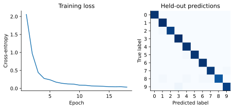

# Convolutional Digit Classifier

Two convolutional layers learn local stroke features directly from the original eight-pixel-wide digits.

[Executed notebook](convolutional_digit_classifier.ipynb) · [Python script](convolutional_digit_classifier.py)

## Network

Pooling reduces the spatial size once. The final linear layer receives all remaining locations.

## Fit and evaluate

The epoch count is fixed. The held-out split is used once for the reported classification scores.

## Recorded output

```text
Accuracy 0.980 | Balanced accuracy 0.980 | MCC 0.978
```

## Reading the result

A falling training loss describes optimisation. The confusion matrix identifies which digits remain hard in an independent image split.



## References

[LeCun et al., Gradient-based learning applied to document recognition](https://doi.org/10.1109/5.726791)

[Alpaydin and Kaynak, Optical Recognition of Handwritten Digits, UCI, CC BY 4.0](https://doi.org/10.24432/C50P49)

[Image and video generators and evaluation](../../gallery/vision.py)
