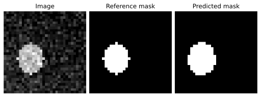

# U-Net Segmentation

A small encoder–decoder finds disks and rectangles under uneven lighting. A skip connection returns fine edges to the decoder.

[Executed notebook](u_net_segmentation.ipynb) · [Python script](u_net_segmentation.py)

## One-scale U-Net

The benchmark uses a compact teaching variant with one downsampling step and a skip concatenation.

## Independent scenes

Binary cross-entropy uses a positive weight of 3 to account for foreground sparsity.

## Recorded output

```text
Mean IoU: 0.880
Mean Dice: 0.934
Pixel precision: 0.901
Pixel recall: 0.978
Pixel accuracy: 0.985
```

## Reading the result

Pixel accuracy is dominated by background. Mean intersection over union and Dice give each test shape equal weight.



## References

[Ronneberger, Fischer and Brox, U-Net (2015)](https://arxiv.org/abs/1505.04597)

[Image and video generators and evaluation](../../gallery/vision.py)
