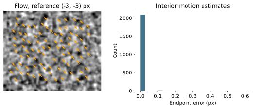

# Lucas-Kanade Tracking

A textured surface translates by a known integer displacement between two frames. Track corners and measure where they land.

[Executed notebook](lucas_kanade_tracking.ipynb) · [Python script](lucas_kanade_tracking.py)

## Motion estimator

An eight-pixel border is excluded from scoring to avoid wrap-around effects.

## Endpoint error

Twenty-four independent textures and translations contribute to the numerical summary.

## Recorded output

```text
Mean endpoint error: 0.005 px | Median: 0.000 px
Within 1 px: 100.0% | Valid fraction: 100.0%
```

## Reading the result

A straight translation provides exact ground truth. Occlusion, lighting changes and a moving camera would require additional tests.



## References

[Lucas and Kanade, An Iterative Image Registration Technique (1981)](https://www.ri.cmu.edu/publications/an-iterative-image-registration-technique-with-an-application-to-stereo-vision-ijcai/)

[OpenCV, motion analysis and object tracking](https://docs.opencv.org/4.x/dc/d6b/group__video__track.html)

[Image and video generators and evaluation](../../gallery/vision.py)
