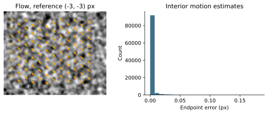

# Farnebäck Optical Flow

A textured surface translates by a known integer displacement between two frames. Estimate a displacement vector at each interior pixel.

[Executed notebook](farneback_optical_flow.ipynb) · [Python script](farneback_optical_flow.py)

## Motion estimator

An eight-pixel border is excluded from scoring to avoid wrap-around effects.

## Endpoint error

Twenty-four independent textures and translations contribute to the numerical summary.

## Recorded output

```text
Mean endpoint error: 0.002 px | Median: 0.000 px
Within 1 px: 100.0% | Valid fraction: 100.0%
```

## Reading the result

A straight translation provides exact ground truth. Occlusion, lighting changes and a moving camera would require additional tests.



## References

[Farnebäck, Two-Frame Motion Estimation Based on Polynomial Expansion (2003)](https://doi.org/10.1007/3-540-45103-X_50)

[OpenCV, motion analysis and object tracking](https://docs.opencv.org/4.x/dc/d6b/group__video__track.html)

[Image and video generators and evaluation](../../gallery/vision.py)
