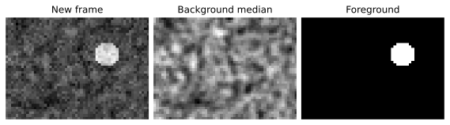

# Background Subtraction

A temporal median estimates a static background from noisy frames containing a moving disk. Subsequent frames supply an independent mask test.

[Executed notebook](background_subtraction.ipynb) · [Python script](background_subtraction.py)

## Generate a fixed-camera sequence

A disk occupies a new location in each frame over a fixed textured background.

## Score foreground pixels

The median uses forty background-estimation frames. Test frames do not contribute to it.

## Recorded output

```text
Mean IoU: 0.993
Mean Dice: 0.997
Pixel precision: 0.993
Pixel recall: 1.000
Pixel accuracy: 1.000
```

## Reading the result

The method assumes that the background occupies a pixel for most of the reference frames. A stationary foreground object breaks that assumption.



## References

[Piccardi, Background subtraction techniques: a review (2004)](https://doi.org/10.1109/ICSMC.2004.1400815)

[Image and video generators and evaluation](../../gallery/vision.py)
