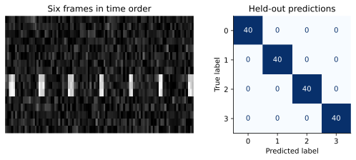

# 3D Convolutional Motion Classifier

A short clip shows a disk moving right, left, down or up. Start position and disk size are randomised independently of the class.

[Executed notebook](3d_convolutional_motion_classifier.ipynb) · [Python script](3d_convolutional_motion_classifier.py)

## Spatiotemporal filters

The convolutional kernels extend across both space and time. Global pooling removes dependence on the final position.

## Train on clips

A new random stream generates the held-out clips. Class numbers 0 through 3 mean right, left, down and up.

## Recorded output

```text
Accuracy 1.000 | Balanced accuracy 1.000 | MCC 1.000
```

## Reading the result

Each clip has periodic boundaries, so starting position gives no systematic class cue. The held-out scores refer to this four-motion family.



## References

[Tran et al., Learning Spatiotemporal Features with 3D Convolutional Networks (2015)](https://arxiv.org/abs/1412.0767)

[Image and video generators and evaluation](../../gallery/vision.py)
